<!-- Panels are drawn by scripts/build.mjs and published to the `output` branch every night. -->

<picture><source media="(max-width: 640px)" srcset="https://raw.githubusercontent.com/Bo0ii/Bo0ii/output/hero-phone.svg"><source media="(prefers-color-scheme: dark)" srcset="https://raw.githubusercontent.com/Bo0ii/Bo0ii/output/hero-dark.svg"></picture>
<picture><source media="(max-width: 640px)" srcset="https://raw.githubusercontent.com/Bo0ii/Bo0ii/output/focus-phone.svg"><source media="(prefers-color-scheme: dark)" srcset="https://raw.githubusercontent.com/Bo0ii/Bo0ii/output/focus-dark.svg"></picture>
<picture><source media="(max-width: 640px)" srcset="https://raw.githubusercontent.com/Bo0ii/Bo0ii/output/stack-phone.svg"><source media="(prefers-color-scheme: dark)" srcset="https://raw.githubusercontent.com/Bo0ii/Bo0ii/output/stack-dark.svg"></picture>
<picture><source media="(max-width: 640px)" srcset="https://raw.githubusercontent.com/Bo0ii/Bo0ii/output/rhythm-phone.svg"><source media="(prefers-color-scheme: dark)" srcset="https://raw.githubusercontent.com/Bo0ii/Bo0ii/output/rhythm-dark.svg"></picture>

<a href="https://cursorhop.com"><picture><source media="(prefers-color-scheme: dark)" srcset="https://raw.githubusercontent.com/Bo0ii/Bo0ii/output/link-web-dark.svg"></picture></a>&nbsp;
<a href="https://www.linkedin.com/in/amr-ahmed-a78aa2249/"><picture><source media="(prefers-color-scheme: dark)" srcset="https://raw.githubusercontent.com/Bo0ii/Bo0ii/output/link-linkedin-dark.svg"></picture></a>&nbsp;
<a href="mailto:amoorafg7881@hotmail.com"><picture><source media="(prefers-color-scheme: dark)" srcset="https://raw.githubusercontent.com/Bo0ii/Bo0ii/output/link-email-dark.svg"></picture></a>

